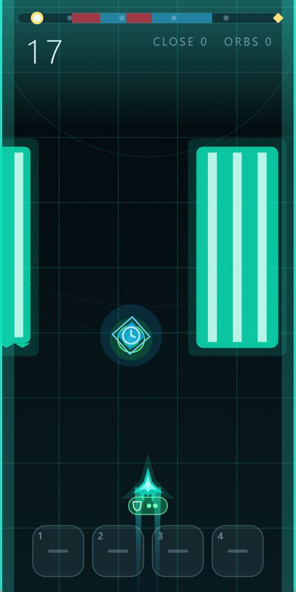
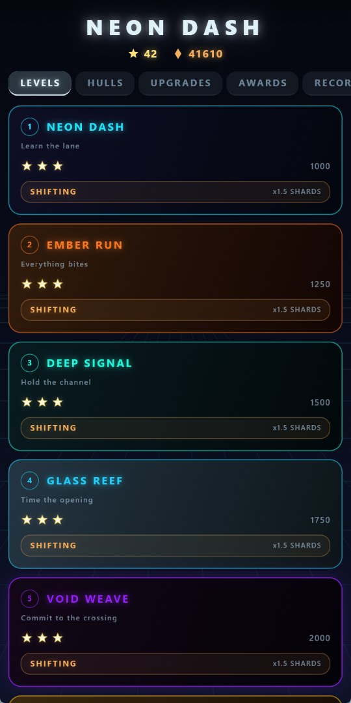
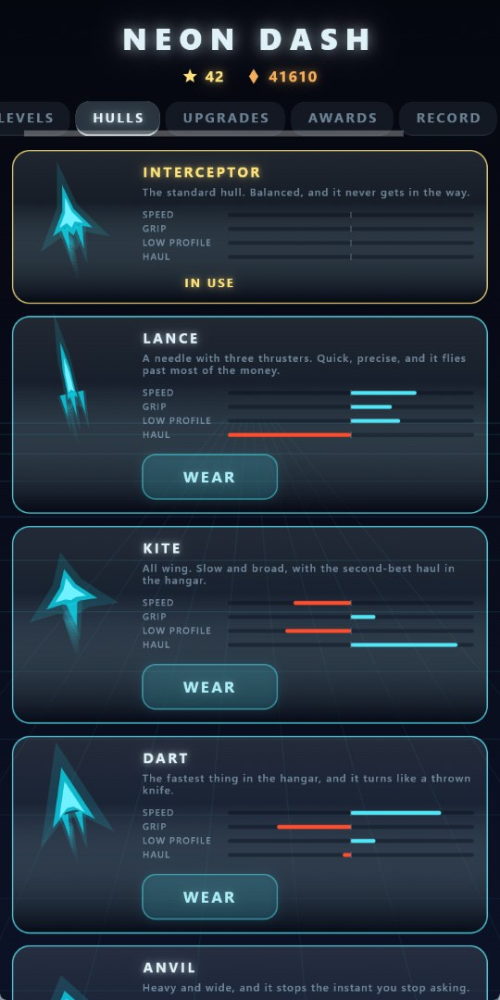
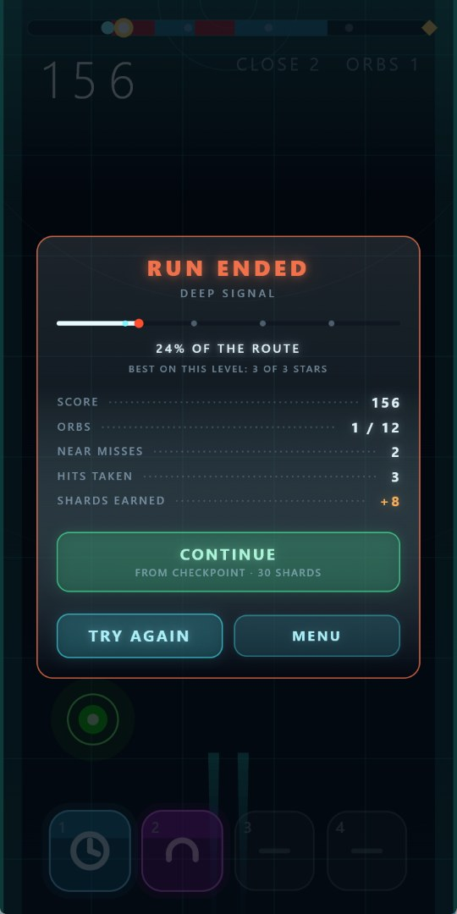

# Playable — портфолио интерактивных мини-игр на Dart/Flutter

Кроссплатформенные мини-игры в стилистике playable-рекламы: мгновенный старт,
один понятный глагол управления, процедурная графика, синтезированный звук,
малый размер.

**Цели:** Windows и Android, адаптив под любое соотношение сторон, стабильные
60/120 fps, ноль аллокаций в горячем пути, **ноль ассетов**.

## Структура

| Путь | Назначение |
|---|---|
| `packages/playable_kit` | Фундамент обеих игр: детерминированный генератор, синтез звука и музыки, накопитель фиксированного шага, атомарное сохранение. **Чистый Dart.** 69 тестов. |
| `packages/playable_core` | Правила игры №1: домен, симуляция, её звуковые реплики. **Чистый Dart.** 355 тестов. |
| `apps/neon_dash` | Игра №1: рендер, анимации, эффекты, ввод, звук. Windows + Android. 109 тестов. |
| `docs` | Анализ рынка, архитектурные решения, бюджеты, журнал замеров настройки. |
| `tools` | `size_report.py` и `frame_report.py` — бюджеты размера и замер кадра, обе игры, без Node. |

Зависимости идут в одну сторону: `kit ← core ← app`. Ядро одной игры ничего
не знает о другой, а `playable_kit` не знает, что такое игра.

## Игра №1: Neon Dash

Вертикальное уклонение, **четырнадцать уровней**. Корабль ведётся
перетаскиванием, удержанием зоны у края экрана или стрелками. За точный проход
в притирку даётся бонус, в центре прохода висит орб, провал — рестарт одним
тапом.

### Как выглядит

| | |
|---|---|
|  |  |
| **Забег.** Сверху маршрут и счётчики, в проходе висит бонус, внизу четыре слота под подобранное. | **Уровни.** Три звезды за каждый и режим `SHIFTING`, который платит в полтора раза больше. |
|  |  |
| **Корпуса.** Четыре оси управляемости, и выигрыш по одной всегда оплачен проигрышем по другой. | **Итог.** Доля пройденного маршрута, разбор по счётчикам и выкуп от чекпоинта. |

Это сама игра, а не отрисованная для витрины картинка: в `pubspec.yaml` у неё
нет ни одного ассета, поэтому всё, что на снимках видно, нарисовано кодом, а
всё, что слышно, синтезировано.

Каждый уровень — своя палитра, свой фон, свой набор схем препятствий, свой
саундтрек и свои бонусы, и чем больше номер, тем больше в нём всего: от четырёх
схем, одного бонуса и нуля порталов на первом до тринадцати, четырёх и четырёх
на последнем. Это проверяется тестом по шести мерам сразу — разнообразие может
повторить предыдущий уровень, но не может ему уступить. Проходится он в одном из двух режимов: базовая
**фиксированная** раскладка, одинаковая каждую попытку (уровень можно выучить,
и три звезды за него значат мастерство, а не везение), и **генерируемая**,
которая открывается после первого прохождения и платит в полтора раза больше.

Сложность растёт не скоростью: у неё жёсткий потолок, за которым окно реакции
упало бы ниже человеческого. Растут **схемы расстановки**, которые открываются
по ходу забега — стены по краям, остров посередине, гребёнка пилонов, стены из
шипов, дрейфующие мины, дышащие створки, змейка с проходами по разным
сторонам — и с 30-й секунды препятствия начинают качаться вбок. Волны приходят
по долям того же темпа, на котором написан саундтрек.

Каждая волна проходима **по построению**, а не по проверке в рантайме: проход
выбирается первым, амплитуда качания вычитается из ширины препятствия, створки
строятся от закрытого состояния, а расстояние между стенками змейки выводится
из времени, которое нужно кораблю на перелёт. То же правило теперь действует и
**между** волнами: если до проёма следующей не успеть, она поднимается выше —
это был настоящий дефект, который нашёл тест.

Поперёк поля изредка приходят **порталы**: ворота, которые нельзя обойти и
которые меняют правила на отрезок — мир идёт быстрее или медленнее, управление
переворачивается, корабль становится меньше. Спавнер считает свои расстояния по
самому быстрому порталу уровня, поэтому гарантия проходимости остаётся
безусловной.

Между забегами — меню с пятью вкладками: уровни, корпуса, улучшения, награды,
рекорд. Осколки, заработанные в поле, тратятся на **двенадцать корпусов**
(шесть силуэтов, включая кольцо, звезду и сердце), на три улучшения, меняющие
правила забега, и на выкуп проигранного забега от последнего чекпоинта по
удваивающейся цене.

У каждого корпуса своя управляемость: скорость, хватка, радиус столкновения и
множитель осколков. Ни один не лучше другого — это **проверяется тестом**:
никакой корпус не смеет обойти другой по всем четырём осям сразу. Магазин
продаёт другой способ летать, а не лёгкий режим.

Больше тридцати **достижений**, и ни одно не хранится в сейве: каждое — это
порог на счётчике, поэтому добавленное завтра достижение засчитает то, что
игрок уже сделал.

Вся графика рисуется кодом: градиенты, бегущая сетка, светящиеся рельсы, шлейф
движения, частицы одним вызовом отрисовки, стеклянные панели управления, десять
стилей фона. Превью корпуса в магазине строится из тех же пропорций, что и
корабль в игре, — магазин физически не может показать не то, что продаёт.

Весь звук тоже генерируется кодом, ни одного аудиофайла. Восемь эффектов из
осцилляторов, шума и огибающих — и **саундтрек у каждого уровня свой**: четыре
слоя, собственные темп, тональность, прогрессия и барабанный рисунок, свинг на
офф-битах, барабанный филл и райзер в последних двух тактах, чтобы петля вела
в собственную первую долю. Слои стартуют сэмпл-в-сэмпл и подмешиваются по ходу
забега: на стартовом экране только барабаны, бас входит с первым кадром, арпеджио
на восьмой секунде, мелодия на двадцатой.

Трек уровня синтезируется при входе в него, в изоляте, — за это отвечает
загрузочный экран, который заодно прогревает конвейеры отрисовки и атлас
глифов.

## Почему ядро отделено от Flutter

Ядро не импортирует ни `flutter`, ни `dart:ui`, и это проверяется тестом, а не
обещанием. Из этого следует три вещи:

1. **Тесты быстрые и без эмулятора** — симуляция детерминирована, 85 тестов
   проходят за доли секунды.
2. **Рендер сменный** — Flutter `CustomPainter` сегодня, Canvas2D для
   web-плейбла завтра, без правок логики.
3. **Домен не протекает в UI** — правила игры нельзя случайно привязать к
   виджету.

Третий пункт проверен на деле: то же ядро компилируется в JS на **56 КБ**
(gzip 18 КБ) против **7.0 МБ** у минимальной сборки Flutter Web. Почему это
важно и почему Flutter Web не годится для playable-рекламы —
в [docs/market-analysis.md](docs/market-analysis.md).

## Как запустить

Нужен Flutter 3.47+ в `PATH`.

Разработка на ПК:

```bash
cd apps/neon_dash && flutter run -d windows
```

Релизная сборка Windows:

```bash
cd apps/neon_dash && flutter build windows --release
```

Android (тулчейн уже стоит, см. «Сборка под Android»):

```bash
cd apps/neon_dash && flutter build apk --release --split-per-abi
```

Управление: свайп или перетаскивание мышью, стрелки `←` `→` либо `A`/`D`,
пробел — старт и повтор.

## Сборка под Android

APK собран. Тулчейн на этой машине стоит так:

| Что | Где |
|---|---|
| JDK 17 | `C:\Program Files\Microsoft\jdk-17.0.20.101-hotspot` |
| Android SDK | `C:\Android\Sdk` — платформа 36, build-tools 36.0.0, NDK 28.2.13676358, CMake 3.22.1 и 3.31.6 |

Два решения по установке стоит объяснить, потому что оба неочевидны.

**SDK лежит в `C:\Android`, а не в `%LOCALAPPDATA%\Android\Sdk`**, куда его
кладёт Android Studio. Запись в `AppData` из песочницы приложения уходит в
`...\Packages\<app>\LocalCache\...`, и установленный таким образом SDK
существует только внутри песочницы: обычный терминал его не видит. Вне
`AppData` редиректа нет.

**Пути прописаны в настройках Flutter, а не в переменных окружения:**

```
flutter config --android-sdk "C:\Android\Sdk"
flutter config --jdk-dir "C:\Program Files\Microsoft\jdk-17.0.20.101-hotspot"
```

Так не приходится трогать системные переменные и политику запуска скриптов.
Цена этого решения: настройки лежат в `%APPDATA%\.flutter_settings`, то есть
**у каждого пользователя свои** — на новой машине или под другим пользователем
обе команды надо повторить, иначе `flutter doctor` снова скажет «Unable to
locate Android SDK».

Пакеты ставились новым `android sdk install`, а не `sdkmanager`: последний
объявлен устаревшим и читает ответы на лицензии с консоли, из-за чего в
неинтерактивной оболочке зависает на вопросе и не ставит ничего.

Сборка — одна команда:

```
flutter build apk --release --split-per-abi
```

`--split-per-abi` даёт по APK на архитектуру вместо одного общего: каждый
примерно втрое легче, потому что не тащит чужой машинный код.

Что получилось:

| APK | Вес | Кому |
|---|---|---|
| `app-arm64-v8a-release.apk` | **17.1 МБ** | любой телефон примерно с 2017 года |
| `app-armeabi-v7a-release.apk` | **13.7 МБ** | старые 32-битные |
| `app-x86_64-release.apk` | **18.8 МБ** | эмуляторы |
| `app-release.apk` | **48.9 МБ** | универсальный, содержит все три |

Лежат в `apps/neon_dash/build/app/outputs/flutter-apk/`.

Уже сделано в проекте:

- **Ориентация** заперта и в манифесте, и в рантайме. Только в рантайме —
  значит кадр-другой после запуска поле успевает перевернуться, и это видно.
- **Системные панели скрыты** (`immersiveSticky`) и прячутся заново при каждом
  возврате в приложение: Android возвращает их после звонка, переключения
  задач или диалога разрешений и не сообщает об этом. На жестовом телефоне эта
  полоса находится ровно там, где правая зона управления.
- **Вёрстка под любой экран** — тест прогоняет восемь форматов, от складня 1:1
  до 21:9, и требует, чтобы поле, обе зоны управления и ряд бонусов остались
  внутри экрана, а время на реакцию не зависело от устройства.
- **Вибрация** не требует разрешения `VIBRATE`: она идёт через системный
  haptic feedback вью, а не через вибромотор напрямую.

Чего **не** сделано:

- **Релиз подписан отладочным ключом** — так ставит `flutter create`, и для
  своего ключа нужен keystore, которого здесь нет. Поставить на телефон это не
  мешает, в Google Play — мешает. Важное следствие: подпись у будущего релиза
  будет другая, и обновить такую установку «поверх» не получится, придётся
  сначала удалить. Ключ создаётся и прописывается в
  `android/app/build.gradle.kts`.
- **Проверка на живом устройстве.** Собралось и подписалось — это проверено,
  запуск на телефоне не проверялся: устройства под рукой нет, а эмулятор
  x86_64 показал бы не ту картину по производительности, ради которой всё
  писалось.
- **Из APK не выкинуты неиспользуемые кодеки** — см. бюджеты.

## Иконка

Иконка рисуется **тем же кодом, что и корабль в игре** — `buildHullPath` из
`render/craft_shape.dart`. Нарисованная отдельно, она выглядела бы как игра
ровно до первого изменения корабля, после чего тихо начала бы врать.

Генератор — тест, потому что только биндинг Flutter даёт канву, которую можно
закодировать в PNG, и потому что это заодно проверка: вариант, который не
рисуется, роняет сборку.

```bash
cd apps/neon_dash && flutter test test/icon_sheet_test.dart
```

Он кладёт в `build/icons/`:

- восемь вариантов по 512 пикселей и лист для сравнения;
- `small.png` — те же восемь в настоящие 64 пикселя, увеличенные без
  сглаживания. Иконку судят по этой полосе, а не по крупной картинке: три
  варианта, выглядевших хорошо, здесь рассыпались;
- `launcher/` — выбранный вариант во всех размерах Android и Windows.

Файлы из `launcher/` копируются в `android/app/src/main/res/mipmap-*` и
`windows/runner/resources/app_icon.ico`.

На Android это **адаптивная** иконка:
фон и передний план лежат раздельно, потому что лаунчер обрезает её своей
маской и двигает слои друг относительно друга — одна картинка, разрезанная
пополам постфактум, дала бы шов ровно там, где виден параллакс.

## Как проверить

```bash
for p in playable_kit playable_core; do (cd packages/$p && dart analyze && dart test); done
```

```bash
cd apps/neon_dash && flutter analyze && flutter test
```

```bash
python tools/size_report.py
```


## Замеренное состояние

Flutter 3.47.7 / Dart 3.13.5, Windows 11, 2026-10-20.

### Результат

| | Результат |
|---|---|
| Тесты | **536 зелёных**: 69 kit + 355 ядро + 112 приложение |
| Анализатор | чисто во всех трёх пакетах |
| Ассеты | ни одной картинки, звука или шрифта |

### Neon Dash

| | Результат |
|---|---|
| Кадр (профиль, автопилот) | build p50 **0.14 мс**, raster p50 **0.36 мс**, худший кадр **0.92 мс** при бюджете 8.33 мс |
| Опоздавшие кадры | **0 из ~6600** подряд, на трёх разных уровнях |
| Windows release | **27.46 МБ**, из них свой код `app.so` — **3.14 МБ** |
| Ядро в JS | **59.2 КБ** |
| Звук в ОЗУ | банк эффектов 236 КБ плюс трек уровня; аудиофайлов в проекте — ноль |
| Ассеты | единственные бинарники — иконки запуска, и те нарисованы кодом игры: `flutter test test/icon_sheet_test.dart` |
| Запуск Windows | проверен, работает |
| Android APK | **17.1 МБ** (arm64), из них свой код `libapp.so` — **2.81 МБ**; универсальный — 48.9 МБ. Запуск на телефоне не проверялся |

Детали бюджетов и разбор, из чего состоит вес, —
в [docs/performance-budget.md](docs/performance-budget.md).

## Документы

- [Анализ рынка playable-рекламы](docs/market-analysis.md) — спеки сетей, что
  работает в креативе, и замеры пригодности Flutter
- [Архитектура](docs/architecture.md) — слои, применённые и **отвергнутые**
  паттерны, адаптив под экраны
- [Бюджеты производительности](docs/performance-budget.md) — кадровый бюджет,
  правила горячего пути, размеры, журнал дефектов, обе игры
